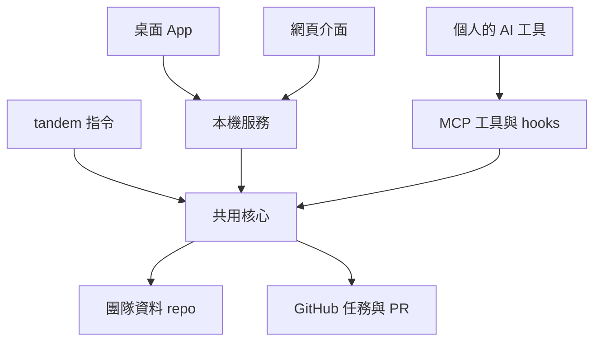

# Tandem 的設計：架構、流程與待驗證事項

Tandem 讓各自用 AI agent 的小團隊共享決定和進度。這份描述目前的 prototype；各階段歷史規格見 [specs](../specs/)，視覺規範見 [DESIGN.md](../apps/web/DESIGN.md)。

## 主要入口

| 入口 | 用途 |
|---|---|
| 任務看板 | 任務、負責人、進度、PR 與等待事項 |
| 專案選單 | 決定、討論、共享脈絡與其他專案操作 |
| Agent 工具與 hooks | 開工報告、查詢與記錄團隊資訊 |

既有 App 對話的實作保留，目前從主要導覽隱藏；個人的主要 AI 對話使用各自的工具。房間從專案選單打開，AI 只在有人按「問 AI」時回答（D-20261118-8urw）。

## 架構

| 位置 | 責任 |
|---|---|
| `apps/desktop` | 視窗、通知、背景服務、自動更新、加入連結 |
| `apps/web` | 看板與專案操作介面 |
| `apps/cli` | 指令、MCP、hooks、本機 API、agent 轉接 |
| `packages/core` | 紀錄、版本、同步、GitHub 與開工報告 |
| `packages/contracts` | 共用型別與驗證規則 |

## 資料邊界

- **公開程式 repo**：程式、產品文件及 `.tandem.json` 的資料 repo 設定。
- **團隊資料 repo**：決定、狀態、`team.md`、`tandem/context/`；由資料儲存層同步到預設分支，不帶出使用者的程式 commit。
- **本機**：App 設定、個人對話、同步狀態與待送資料。個人對話預設不分享。
- 未設定獨立資料 repo 的專案沿用原本的 `tandem/` 儲存方式；涉及私密訊息的新功能須要求獨立資料 repo。

同步不切換使用者分支、不改使用者工作檔案、不強制推送。離線先存待送區；有衝突就顯示錯誤並保留資料。Git 子程序移除繼承的 repo 指向變數，避免 hook 把操作帶到別的 repo。

## 協作流程

1. **開始與加入**：用 GitHub 登入、選擇專案、邀請隊友。程式與資料 repo 的權限分別處理。
2. **開工與繼續**：開工報告提供相關變動；進行中的對話會收到隊友的新決定和共享脈絡備註。
3. **記決定**：agent 先產生草稿，由本人確認才記錄。原話逐字，沒有原話就標示 agent 整理。
4. **問人與任務**：必須對方回答才能繼續時開問題；任務以 GitHub Issue 記錄。
5. **共享脈絡**：讀取回傳版本；修改帶原版本，衝突時重新讀取與合併。文字進出檢查疑似憑證。
6. **收尾**：只更新自己的狀態，提供可開啟的成品連結與已知限制。

## AI 與權限

Tandem 執行使用者自己安裝與登入的工具，不代管 AI 憑證。工具狀態、認證、模型清單與真實對話應分別驗證。App 對話涉及動作時沿用既有核准流程。

隊友的文字、討論與檔案內容一律是外部資料，不能增加權限。共享訊息與對話只允許這個專案的內容；本人啟用與分享確認不能由隊友代替。

## 設計原則

功能圍繞小團隊的實際協作需求；畫面、文案與圖示由 Tandem 自己設計。背景研究保存在私人團隊資料庫。使用第三方程式碼或套件時仍保留必要授權聲明。

## 已知限制與後續驗證

- 第 001–003 階段的規格是歷史紀錄，不能當成目前每個 provider 都已實測。
- 房間仍只有模擬資料驗證；本機與 MOCK 證據不代表兩人協作已通過。
- 正式對外名稱仍待團隊決定。
- 指令、MCP 與本機服務部分流程有重複；新功能應共用核心規則。
- Agent 訊息、對話分享與交接需補兩人實測，成員離線及權限變更也須驗證。
