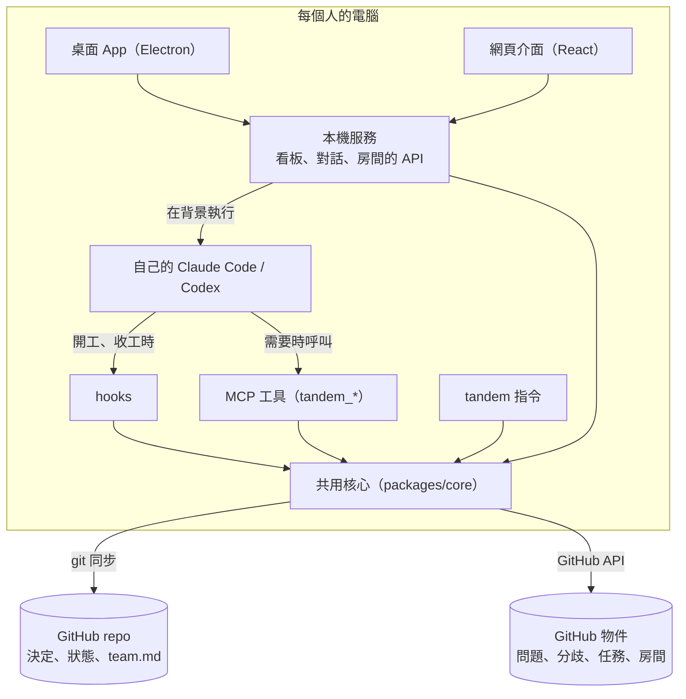

# Tandem 的設計：架構、流程、決定和待解問題

這份寫的是 Tandem **現在**長什麼樣（到 0.2.1 為止），以及還沒解決的問題。為什麼要做、想過哪些做法在〈發想和點子〉；參考過的產品在〈研究〉。每個功能的細節（怎麼做、技術選擇、資料格式、指令）在 [`specs/`](../specs/)。

**這只是一個 prototype 的紀錄，不是定案。** 下面的決定和做法都是 Jielle 一個人做 prototype 時的選擇，沒有記成正式決定。等 Roy 測試過後，兩個人再從一張白紙一起重新決定，不需要被這裡的框架限制。

- **第一部分**：現在的設計。架構、資料放哪、主要流程、決定清單、已知的架構問題。
- **第二部分**：待解問題和要驗證的事。

---

## 第一部分：現在的設計

### 1. 一句話

每個人照常用自己的 AI agent（Claude Code 或 Codex）工作；agent 會把會影響別人的決定、問題和狀態記到團隊共用的 GitHub repo，隊友的 agent 開工時就會主動告訴他「跟你有關的變動」。桌面 App 讓人一眼看到大家在做什麼、在 App 裡直接跟自己的 AI 對話，也能開一個大家一起跟 AI 討論的房間。

### 2. 使用者看得到的四樣東西

| 東西 | 做什麼 |
|---|---|
| **看板** | 每個人在做什麼、卡在哪、誰在等誰；最近的決定、還開著的問題和任務、成品連結 |
| **跟 AI 對話** | 在 App 裡用自己的 Claude 或 Codex，不用開終端機；AI 自動知道團隊的事，也能直接記錄 |
| **房間** | 一段團隊都能打字的對話，AI 跑在主持人的電腦上，能隨時整理筆記 |
| **agent 的開工報告和記錄** | 不管在 App 裡還是終端機，agent 開工時用五行以內講跟你有關的變動；做了決定會先給你看草稿再記 |

### 3. 架構

| 元件 | 做什麼 |
|---|---|
| **桌面 App** | 包著本機服務和網頁介面；內建 git 和 `tandem` 指令；自動更新 |
| **本機服務** | 給網頁介面用的 API：登入、專案、看板、AI 對話、房間、設定 |
| **網頁介面** | 看板、跟 AI 對話、房間三個分頁 |
| **共用核心** | 讀寫紀錄、git 同步、呼叫 GitHub、算開工報告、裝 agent 設定 |
| **`tandem` 指令** | 給人和 agent 用：`init`、`invite`、`join`、`brief`、`decide`、`status`、`ask`、`disagree`、`resolve`、`task`、`sync`、`check`、`doctor` 等 |
| **MCP 工具** | 讓 agent 直接呼叫：`tandem_brief`、`tandem_decide`、`tandem_decisions`、`tandem_status`、`tandem_ask`、`tandem_disagree`、`tandem_task`、`tandem_check`、`tandem_context_list`、`tandem_context_read`、`tandem_context_write`；效果和指令一樣 |
| **hooks** | 開工時給 agent 開工報告；收工時如果有改動，提醒更新狀態 |

**怎麼接上 agent**：Tandem 在專案裡寫好幾樣設定，兩家都讀同一套：
- `AGENTS.md` 裡一段很短的規則（`CLAUDE.md` 只引用它）
- 三個 skill：記決定、開問題、更新狀態，用到時才載入
- MCP 設定（`.mcp.json`、`.codex/config.toml`）
- hook 設定（`.claude/settings.json`、`.codex/hooks.json`）

**在 App 裡跟 AI 對話**：Tandem 在背景執行使用者自己裝的原版 `claude`（或 Codex 的 app-server），登入走它們自己的流程。Tandem 不經手任何 AI 帳號或金鑰。AI 要改檔案、跑指令時，會在 App 裡跳出核准卡。

### 4. 資料放在哪

| 放哪 | 放什麼 | 怎麼同步 | 特性 |
|---|---|---|---|
| **repo 裡的檔案**（`tandem/`） | 決定（`decisions/`）、每人的狀態（`status/<帳號>.md`）、團隊習慣（`team.md`）、共享脈絡（`context/`） | git；紀錄直接推到 main，不開 PR | 離線也能寫、有完整歷史、寫了不改（推翻要新增一筆並寫「取代誰」） |
| **GitHub 物件** | 問題和分歧（Discussions，加標籤；沒開 Discussions 就用 Issues）、任務（Issues）、房間（Discussions，內文開頭有房間標記） | GitHub API | 要連網、即時、有通知、每句話有作者和網址 |
| **本機** | App 設定（`%APPDATA%\Tandem\app.json`）、AI 對話紀錄、每個 repo 的同步狀態（`.git/tandem/`） | 不同步 | 只有自己看得到 |

GitHub 登入用裝置碼流程（像 GitHub Desktop），沒裝 `gh` 也能用。

**共享脈絡**（`tandem/context/`）：一個大家和大家的 agent 都能讀寫的資料夾。`notes.md` 放背景、架構、需求，其他檔案放規格、圖、草圖、比較長的報告。

- 只放在團隊資料 repo（有 `.tandem.json` 就是那個私人 repo，沒有就是程式碼 repo）的 `tandem/context/`，不放別的地方；新隊友加入就自動有。
- 規則：相對路徑、不能有 `..`、最多 3 層（例如 `specs/api/v1.md`）、名稱只能用文字、數字、`. _ -`；文字檔 `.md .txt .json .csv .svg .mmd`，圖片 `.png .jpg .jpeg .gif .webp`（傳輸用 base64，存成真的二進位檔）；每個檔案最多 2 MB。
- 讀寫都經過 DataStore，跟決定一樣走 outbox 和同步；commit 訊息是 `tandem: context <路徑> (@帳號)`，第二段是「原因」。清單上的「誰改的」從這行讀出來。
- 檔案鎖（樂觀鎖）：每次讀都拿到版本（git blob sha）。寫的時候可以帶 `expectVersion`（新檔給 null），如果檔案在那之後被改過就拒絕，訊息是「這個檔案剛被 @x 改過，請重新載入再改」。寫入前先比一次，推送時（outbox 抓到最新的遠端之後）再比一次，所以兩個人同時存也不會互相蓋掉；被拒絕的那筆移到 `.git/tandem/conflicts/`。
- 金鑰防護：文字內容和原因在寫入前檢查，看起來像金鑰就拒絕，不存也不推送。偵測常見的 token 開頭（GitHub、OpenAI、Anthropic、AWS、Google、Slack、Stripe）、PEM 私鑰、`.env` 式的 `XXX_KEY=` 長隨機值、網址裡的密碼；錯誤訊息只說第幾行、像哪一種，不重複金鑰本身。偵測器在 `packages/core/src/context/secrets.ts`，之後 agent 之間的訊息也會用。
- agent：`tandem_context_list`、`tandem_context_read`（回傳內容和版本；圖片回傳圖片）不用核准；`tandem_context_write`（path、content、`why` 必填、`expectVersion` 選填）跟其他寫入一樣要核准。說明裡要 agent 大工作前先讀 `notes.md`、只寫使用者要分享的、不放金鑰。
- 開工報告：列出上次之後隊友改過的脈絡檔案（每個一行，最多 5 個，自己改的不列），有 `notes.md` 就附上前 15 行；對話中間的「新決定」提醒也會一起提到新改的脈絡檔案（同一個節流）。
- 看板：⋯ 選單的「脈絡」頁。本機服務的路由：`GET /api/projects/:id/context`、`GET|PUT|DELETE /api/projects/:id/context/file`（衝突回 409）。

**團隊資料可以放在另一個 repo**（決定 D-20261117-7m4b）。程式碼 repo 是公開的話，`tandem/` 裡的原話、每個人的狀態也都公開了，所以團隊資料可以搬到另一個私人 repo；程式碼、PR、任務（Issues）、Discussions 留在程式碼 repo。

- 設定：程式碼 repo 根目錄的 `.tandem.json`，例如 `{ "dataRepo": "my-team/team-data" }`。沒有這個檔、或沒寫 `dataRepo`，資料就跟程式碼放在同一個 repo（原本的做法，私人 repo 照舊）。讀的順序：工作資料夾裡的檔案，沒有就讀程式碼 repo 遠端預設分支上的那份，所以還沒切到新分支的人也會跟著改。
- 本機副本：每個資料 repo 一個資料夾，放在 App 設定旁邊（`<App 設定資料夾>/data/<owner>__<name>/`），只有 `.git`、不 checkout。第一次用到時自動建立（`git init`、遠端設成 GitHub 的 https 網址、`fetch`），認證跟程式碼 repo 一樣（token 用環境變數帶，不寫進設定）。資料 repo 是全新空的也可以，第一筆寫入會建立 `main`。裡面的路徑不變（`tandem/decisions`、`tandem/status`、`tandem/team.md`）。
- 分工：讀寫紀錄、同步、brief、看板、MCP 工具、hook 讀紀錄都用資料 repo；hook 判斷「這次有沒有改程式碼」、PR、任務、開資料夾都用程式碼 repo。看板上決定的連結指向資料 repo。
- 邀請：資料分開時，邀請隊友會先邀請程式碼 repo、再邀請資料 repo，兩個結果都會回報；對方接受程式碼 repo 的邀請時，會一起接受資料 repo 的邀請。
- 搬家（只做一次）：`tandem data move --to owner/name`（可加 `--dry-run` 先看）。它把程式碼 repo 遠端預設分支上的 `tandem/decisions`、`tandem/status`、`tandem/team.md` 用一個 commit 複製到資料 repo（已經有的檔案不覆蓋、不刪任何東西，再跑一次不會多做事），然後在工作資料夾寫入 `.tandem.json`。它**不會**刪掉程式碼 repo 裡的舊檔、不 commit、不推送，只印出要你自己用 PR 做的 `git rm` 和 `git add .tandem.json`。
- 注意：舊內容還留在程式碼 repo 的 git 歷史裡，公開 repo 的話任何人都看得到。我們不改寫歷史、不 force push。還沒更新 Tandem 的人會繼續寫到程式碼 repo，PR 合併前寫進去的新紀錄可以再跑一次 `tandem data move` 補過去。

### 5. 主要流程

**開始專案、邀請隊友**
1. 在 App 裡選一個 GitHub repo，Tandem 建好 `tandem/` 資料夾和給 agent 的設定。
2. 輸入隊友的 GitHub 帳號按邀請，拿到一個連結。
3. 隊友打開連結、用 GitHub 登入，邀請自動接受、專案下載好、看板打開。

**開工報告**
1. agent 開工時 hook 自動執行：先同步，再算出上次之後跟你有關的變動（新決定、等你的問題、狀態變化）。
2. agent 在第一個回覆用五行以內告訴你，附連結；沒有變動就不講，講過的不重複。

**記決定**
1. 你在對話中做了會影響別人的決定。
2. agent 產生草稿（逐字原話、決定、原因、強度），問你「我記成這樣，對嗎？」
3. 你確認後才寫入並推到 main；隊友下次開工就會知道。

**問問題、意見不同、派任務**
- 一定要對方回答才做得下去：開問題（Discussion），對方收到 GitHub 通知，看板上顯示「誰在等誰」。
- 可以先做、之後再改的事：直接記成決定，不開問題。
- 意見不同：開分歧討論，雙方各自寫自己的立場。
- 任務：開 Issue 指派給人。

**更新狀態、看板**
- 一段工作告一段落，agent 更新你自己的狀態檔（在做什麼、下一步、被什麼擋住、成品連結）。
- 看板讀狀態、決定、GitHub 物件和最近的 commit、PR，讀的時候現算，不另外存一份。

**在 App 裡跟 AI 對話**
1. 選要用哪一家、哪個模型，開始對話。
2. AI 跑在你的電腦、用你的帳號，自動帶著團隊的狀況。
3. 改檔案、跑指令時跳核准卡，你按了才做。

**房間**
1. 主持人開房間，Tandem 建一則 GitHub Discussion。
2. 隊友在 App 裡（或直接在 GitHub 上）留言，主持人的電腦每 4 秒收一次，送進主持人的 AI。
3. AI 的回覆以 🤖 開頭貼回討論；改檔案、跑指令要主持人核准。
4. 主持人隨時可以請 AI 整理筆記（重點、決定、待辦、未解決的問題），寫進討論內文；結束時整理一次並關閉討論。

**同步**
- 背景每分鐘從 GitHub 拉一次，GitHub 上的問題和動態每 3 分鐘查一次。
- 只同步 `tandem/` 裡的紀錄，不動使用者自己的工作檔案；有衝突就停下來，絕不強制推送。

**發行和更新**
1. 執行 `npm run release -- <版本> "<這版改了什麼>"`，推一個版本標籤。
2. GitHub Actions 在雲端打包 Windows 安裝檔，上傳到 `tandem-releases`。
3. 已安裝的 App 下次開啟時自動更新。

### 6. prototype 時期的決定

原本的 19 筆決定紀錄已經從 repo 刪除（還在 git 歷史裡），**刻意不記回去**，只留在這份文件當參考。下面的「有效」是指 prototype 現在照這樣做，不代表之後要沿用。

**產品方向**

| 決定 | 狀態 |
|---|---|
| 目標使用者是臨時一起做專案的小團隊（朋友的副業、黑客松隊伍） | 有效 |
| 核心只做一件事：讓不同人的 agent 共享決定和脈絡 | 有效 |
| 最重要的標準是輕鬆（硬性） | 有效 |
| 流程不寫死：格式和存放位置固定，其他交給 AI 判斷（Jielle 和 Roy） | 有效，原本是 Roy 的想法（經轉述） |
| 要有介面，看得到每個人的進度、專案狀態、待辦，能點到成品 | 有效，已做 |
| 要有大家都能輸入的共用房間，用主持人的訂閱，不綁開會工具 | 有效，已做 |
| 房間的設計（GitHub Discussion、話直接送 AI、動作要主持人核准、能整理筆記） | 暫定，等 Roy 一起決定 |
| 在 App 裡用自己的 AI，訂閱或 API key 都能用；不用 Agent SDK 配訂閱、不經手 AI 憑證 | 有效，已做 |

**做法原則**

| 決定 | 狀態 |
|---|---|
| 優先照搬已經被很多人驗證過的做法 | 有效 |
| 用 Tandem 開發 Tandem | 有效 |
| 不先試用人工版，直接做完整版再調整 | 有效 |
| 先假設使用者都會用 GitHub | 有效 |
| 先只做我們自己的系統加上 GitHub（Discord、Slack 之後） | 有效 |
| 學 T3 Code：一個本機核心加一套網頁介面 | 有效，已包成桌面版 |

**repo 和流程**

| 決定 | 狀態 |
|---|---|
| 只開一個私人 repo，開發紀錄和程式碼都放這裡 | 有效 |
| 紀錄、狀態和筆記直接推到 main，不開 PR | 有效 |
| 不沿用 studio 的流程規則，自己設計 | 有效 |
| repo 建在 sudo-studio-lab，暫定名稱 Tandem | 有效，正式名稱等 Roy |

**已經過時**

| 決定 | 為什麼過時 |
|---|---|
| 001 階段先借用 `gh` 登入 | 已改成自己的裝置碼登入，`gh` 只當備援 |

### 7. 已知的架構問題

整理時發現、還沒動手的地方：

1. **同一個動作在三個入口各寫一次。** 記決定、更新狀態、開問題在 `tandem` 指令、MCP 工具、本機服務各自呼叫核心，檢查和錯誤訊息各寫各的。加一個功能要改三處。
2. **給 agent 的說明散在五個地方。** AGENTS.md 區塊、skill、MCP 說明、開工報告、hook 輸出。和「流程不寫死」衝突：說明越多越細，agent 越被寫死。
3. **兩種儲存的分界沒寫下來。** repo 檔案和 GitHub 物件的分法本身合理（結論放 repo、對話和進行中的事放 GitHub），但沒寫成規則，加新功能時每次重想。
4. **本機服務的程式太大（約 880 行）。** 登入、專案、看板、對話、房間、核准、設定全在一個檔案。
5. **房間的 AI 跑在主持人電腦上。** 主持人關機房間就停；每 4 秒查一次 GitHub。人少時夠用，是刻意的取捨。
6. **GitHub 用戶端的程式也很大（約 850 行）。** 可以照物件種類拆開，不急。

---

## 第二部分：待解問題和要驗證的事

### 1. 等 Roy 一起決定

原本開給 Roy 的四個問題，只留下[正式名稱](https://github.com/sudo-studio-lab/tandem/discussions/2)；另外三題已經刪掉，問題記在這裡，等 Roy 測試完再一起從頭談：

| 問題 | 關係到什麼 |
|---|---|
| 派工時，是不是一律要對方本人看過、按下去才執行？ | 派工、背景工人 |
| 房間這樣做（GitHub Discussion、話直接送 AI、動作要主持人核准）可以嗎？ | 房間 |
| 兩個人（或兩個 agent）意見不同時，誰決定？ | 分歧怎麼收尾 |

另外兩件事也在等 Roy：
- **他自己的痛點和想要的東西。** 目前只有他 agent 寫的文件和 Jielle 的轉述，沒有他自己的話。
- **他文件裡問 Jielle 的四個問題沒有正式回覆**：用哪家模型和方案、三條路傾向哪條、我們跟 Cursor 和 Omnigent 差在哪、意見不同時誰決定。

### 2. 還沒驗證的

| 項目 | 現況 |
|---|---|
| **核心那一圈有沒有用** | 「一個人記決定 → 對方開工時被告知 → 不用看文件就懂」還沒有兩個人真的跑過一次 |
| **Codex** | adapter 照文件寫好，交給 Roy 在他的電腦上測，還沒測 |
| **房間** | 只在模擬資料下測過，沒有用真的 GitHub 和真的 AI 跑過 |
| **從 0.1.0 升級** | 安裝位置換過，舊版升級上來有沒有問題沒驗證 |
| **該記的有沒有被記下來** | agent 會不會在該記的時候記、開工報告是不是對方真正需要知道的，這才是 Tandem 的價值所在 |

### 3. 還沒定論的點子

這些討論過、但沒有任何紀錄說是做還是不做：

| 點子 | 現況 |
|---|---|
| 團隊大腦 | 建議拿掉（衝突在記決定時當場提示、太久沒回用程式標紅就好），沒有定論 |
| 對話權限模式 | 提議三種模式（完全授權、自動接受修改、需要核准），預設自動接受修改，草稿沒寫入 |
| 交接確認、交棒驗證 | Jielle 和 Roy 都想要，還沒做 |
| Readback 的其他三件事 | 回條、照原話檢查成品、交棒驗證；只做到原話保存的一半 |
| 助理 agent 先審 | 沒做，也沒記為什麼放下 |
| 白板 | 沒做 |
| 專家團隊、視角審查 | 沒做 |
| 模擬使用者 | 沒排進任何規格 |
| 三條路（用現成、做外掛、自己做） | 實際越做越接近自己做，沒記成決定 |
| 不熟 GitHub 的人怎麼上手 | 先假設都會用 GitHub |

### 4. 之後一起決定的

- **要不要重新記決定。** 現在 repo 裡沒有任何決定紀錄，開工報告只會報問題和狀態。等 Roy 來，從零開始記。
- **已知的架構問題（第一部分第 7 節）** 要不要動、先動哪個。
- **卡點紀錄要不要恢復。** 原本「卡住就記一筆到 `notes/friction/`」的規則已經拿掉。
